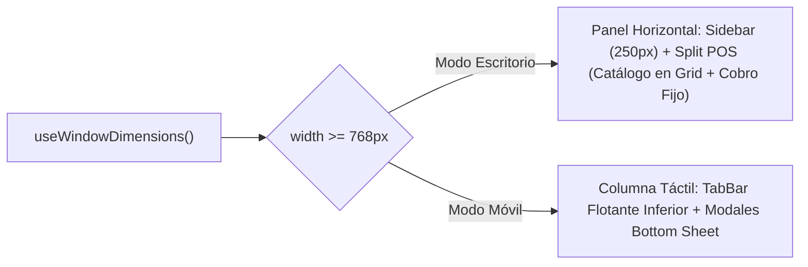

# AGENT_STARTUP_CONTEXT.md — Resumen Maestro de Arranque

> **Versión Actual Estable:** **v1.0.1**  
> **Para cualquier IA, Agente o Desarrollador que inicie una sesión en este repositorio:**  
> Lee este archivo primero. Contiene toda la verdad técnica, el estado del proyecto, la ubicación del código activo y las reglas obligatorias para no romper la arquitectura.

---

## 1. Identidad del Proyecto
- **Nombre de Proyecto / Repositorio (Personal):** `elytras`
- **Nombre Comercial / Display en App:** `Sebas POS`
- **Propósito:** Sistema de Punto de Venta (POS), inventario multi-lote por proveedor, control de garantías por ítem y arqueo contable de caja, especializado para tiendas de telefonía móvil y accesorios.
- **Estética Visual:** **Apple HIG / Liquid Glass** sobre fondo oscuro **OLED Puro (`#000000`)**, con desenfoques translúcidos, resortes elásticos y tipografía tabular sin serifas superfluas.

---

## 2. Ubicación del Código Activo vs. Legado

| Directorio | Propósito | Estado |
| :--- | :--- | :--- |
| **`universal/`** | **CÓDIGO FUENTE ACTIVO Y PRODUCTIVO** | Proyecto Expo SDK 57 con `react-native-web`, PWA instalable, Supabase Auth y PostgreSQL RLS. **Todo cambio debe realizarse aquí.** |
| `DOCUMENTOS/` | Documentación técnica centralizada | Fuente de verdad única (`MASTER_DOCUMENT.md`, `SECURITY_MULTITENANCY_GUIDELINES.md`, etc.). |
| `src/` | Prototipo web original con Vite (v1.0) | Solo lectura / Referencia histórica. **No editar.** |
| `sebas-pos/` | Repositorio raíz inicial | Conservado como backup. **No editar.** |

---

## 3. Stack Tecnológico de `universal/`
- **Plataforma:** Expo SDK 57 (`~57.0.31`), React 19.2 (`19.2.3`), React Native 0.86 (`0.86.3`), `react-native-web`.
- **Modo de Distribución:** Progressive Web App (PWA) instalable en iPhone/Android/PC + compatibilidad con Expo Go nativo.
- **Backend & Base de Datos:** Supabase Cloud (PostgreSQL 15+ con Row Level Security habilitado).
- **Librerías Clave:** `expo-blur`, `expo-haptics`, `@react-native-async-storage/async-storage`, `react-native-safe-area-context`, `@expo/vector-icons`.

---

## 4. Arquitectura Multi-Tenant y Seguridad Estricta (Zero-Trust)

> [!CRITICAL]
> **Regla de Oro:** Múltiples tiendas independientes comparten la misma base de datos. Está **terminantemente prohibido** exponer datos de otra tienda.

1. **Defensa en Profundidad Obligatoria:**
   - **En el cliente (Frontend):** Toda consulta o mutación DEBE llevar explícitamente `.eq('store_id', this.storeId)`. Nunca confíes únicamente en la base de datos.
   - **En el servidor (PostgreSQL):** Todas las tablas (`products`, `sales`, `suppliers`, `closures`, `store_settings`) tienen RLS activo mediante la función `is_store_member(store_id)`.
2. **Prohibición de Secret Keys en Frontend:**
   - **Solo se permiten:** `EXPO_PUBLIC_SUPABASE_URL` y `EXPO_PUBLIC_SUPABASE_ANON_KEY`.
   - **Prohibido:** Llaves maestras (`service_role`, `sb_secret_...`) en cualquier parte del código cliente.
3. **Guardas de Sesión:**
   - [`App.js`](file:///c:/Users/Sebas/Desktop/sebas-pos/universal/App.js) bloquea el montaje de las vistas del POS si `!session` o si no se ha resuelto el `store_id`. El usuario siempre pasa por [`AuthScreen.js`](file:///c:/Users/Sebas/Desktop/sebas-pos/universal/src/screens/AuthScreen.js).
4. **Limpieza en Logout:**
   - Al cerrar sesión (`signOut`), se purga la memoria reactiva y la caché de `AsyncStorage` para que un usuario posterior en el mismo dispositivo no vea residuos.

---

## 5. Diseño Responsivo Inteligente (Escritorio vs. Móvil)

El punto de corte responsivo se evalúa dinámicamente con `useWindowDimensions()` en **`768px`**:



- **Escritorio (`width >= 768px`):**
  - Barra lateral fija [`DesktopSidebar.js`](file:///c:/Users/Sebas/Desktop/sebas-pos/universal/src/components/DesktopSidebar.js) (250 px).
  - POS dividido: Catálogo a la izquierda en cuadrícula de 2 a 3 columnas; a la derecha, **Panel de Cobro en Tiempo Real** ([`CheckoutForm`](file:///c:/Users/Sebas/Desktop/sebas-pos/universal/src/sheets/CheckoutSheet.js#L9)) que permite facturar sin abrir ventanas modales.
  - Inventario multi-columna con botones de acción textuales.
- **Móvil (`width < 768px`):**
  - Columna única centrada, `TabBar` flotante inferior con safe area insets y `CheckoutSheet` emergente.

---

## 6. Reglas de Negocio Cruciales
1. **Sin Precios Quemados (Precios Dinámicos):** Los precios de venta sugeridos se adaptan al momento del cobro; el cajero puede editar el precio unitario o el monto total final (descuento automático).
2. **Multi-Lote de Proveedores:**
   - Cada producto mantiene un array `batches: [{ id, supplierId, supplierName, qty, unitCost, date }]`.
   - Al agregar al carrito, se selecciona automáticamente el lote del **proveedor con mayor stock disponible**.
   - El cajero puede cambiar manualmente de proveedor en el carrito mediante chips de colores.
3. **Garantías por Ítem:**
   - Cada producto vendido tiene una garantía individual configurable (por defecto 30 días). En [`HistorialScreen.js`](file:///c:/Users/Sebas/Desktop/sebas-pos/universal/src/screens/HistorialScreen.js), cada ítem puede marcarse como *"Garantía reclamada"* o revertirse.
4. **Arqueo y Cierres de Ciclo:**
   - En [`ResumenScreen.js`](file:///c:/Users/Sebas/Desktop/sebas-pos/universal/src/screens/ResumenScreen.js), el usuario puede liquidar ciclos seleccionando rango de fechas con cálculo automático de: Ingresos, Utilidad real (`Ingresos - Costo de Mercancía Vendida`), Inversión recuperada y Efectivo real reportado en caja.

---

## 7. Mapa de Archivos Críticos en `universal/src/`

```text
universal/
├── App.js                                  # Orquestador responsivo, verificación de sesión y Shell
├── src/
│   ├── ThemeContext.js                     # Colores OLED, modo dark/light/system
│   ├── components/
│   │   └── DesktopSidebar.js               # Barra lateral fija de navegación en PC
│   ├── data/
│   │   ├── authService.js                  # Login flexible (correo/tienda), signup, resetPassword
│   │   ├── supabaseClient.js               # Instancia oficial de Supabase con AsyncStorage
│   │   ├── SupabasePOSRepository.js        # Adaptador remoto multi-tenant con debounce y reconciliación
│   │   └── usePOSStore.js                  # Hook central de estado reactivo (lotes, ventas, carrito)
│   ├── domain/
│   │   └── formatters.js                   # Formato $ COP (sin espacios), sembrado y cálculo de garantías
│   ├── screens/
│   │   ├── AuthScreen.js                   # Login, Registro (clave duplicada) y ResetPasswordScreen
│   │   ├── POSScreen.js                    # Punto de venta responsivo (Split PC / Flujo móvil)
│   │   ├── InventarioScreen.js             # Cuadrícula de inventario, modo costos y mermas (+1/-1)
│   │   ├── HistorialScreen.js              # Lista de ventas y garantías individuales
│   │   └── ResumenScreen.js                # Métricas financieras y arqueos de cierre
│   ├── sheets/
│   │   ├── CheckoutSheet.js                # CheckoutForm compartido (panel en PC, sheet en móvil)
│   │   ├── ProductSheet.js                 # Detalle de producto y entrada de nuevos lotes
│   │   └── TopMenu.js                      # Menú flotante móvil y SuppliersSheet
│   └── ui/
│       └── kit.js                          # Primitivas Liquid Glass (Glass, Sheet, PriceInput, Card, Tap, Txt)
```

---

## 8. Comandos de Terminal Habituales

```powershell
# 1. Posicionarse en la carpeta activa
cd universal

# 2. Iniciar servidor local Expo con limpieza de caché
npx expo start -c
# Presionar 'w' para abrir en navegador Web/PWA
# Escanear el código QR con Expo Go en iPhone

# 3. Compilar el bundle estático de producción web (para Vercel/Netlify)
npx expo export --platform web
```

---

## 9. Índice de Documentos Detallados en `DOCUMENTOS/`

Para profundizar en cualquier aspecto, consulta los archivos especializados:
- [`MASTER_DOCUMENT.md`](file:///c:/Users/Sebas/Desktop/sebas-pos/DOCUMENTOS/MASTER_DOCUMENT.md): Arquitectura completa y registro histórico de decisiones (ADR-001 al ADR-025).
- [`SECURITY_MULTITENANCY_GUIDELINES.md`](file:///c:/Users/Sebas/Desktop/sebas-pos/DOCUMENTOS/SECURITY_MULTITENANCY_GUIDELINES.md): Manual estricto de aislamiento `store_id`, políticas RLS y auditoría.
- [`CHANGELOG_REQUESTS.md`](file:///c:/Users/Sebas/Desktop/sebas-pos/DOCUMENTOS/CHANGELOG_REQUESTS.md): Registro cronológico de versiones desde v1.0 hasta v2.6.
- [`DESIGN_SYSTEM.md`](file:///c:/Users/Sebas/Desktop/sebas-pos/DOCUMENTOS/DESIGN_SYSTEM.md): Tokens de color OLED, curvaturas de resorte iOS y componentes Liquid Glass.
- [`PRD.md`](file:///c:/Users/Sebas/Desktop/sebas-pos/DOCUMENTOS/PRD.md): Documento de requisitos del producto y especificación funcional del MVP.

