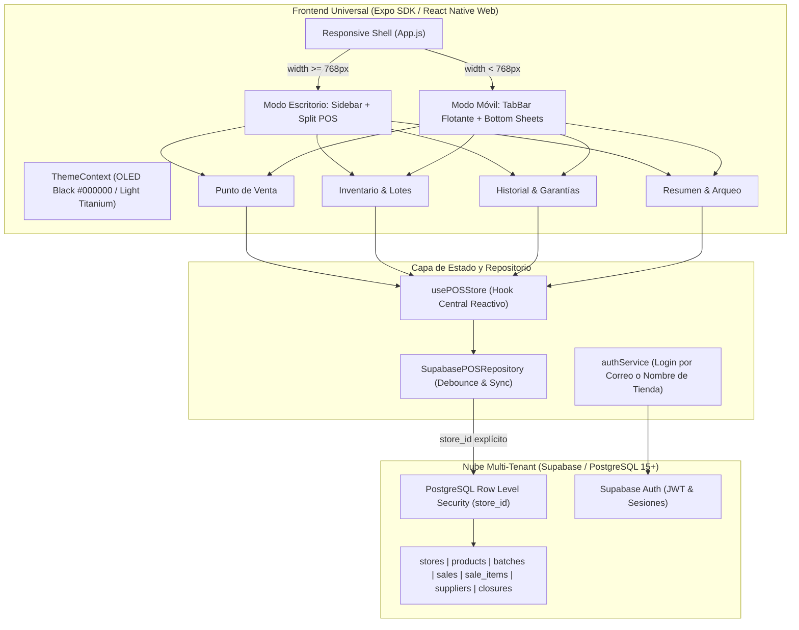

# Sebas POS (elytras)

<div align="center">


**Sistema Universal de Punto de Venta (POS), Control de Inventario Multi-Lote por Proveedor, Trazabilidad de Garantías por Ítem y Arqueo Financiero de Caja.**

*Diseñado para tiendas de tecnología y telefonía móvil con experiencia visual inspirada en iOS Liquid Glass sobre fondo OLED Puro (`#000000`).*

</div>

---

## 📋 Tabla de Contenidos

1. [Visión General](#-visión-general)
2. [Arquitectura del Sistema](#-arquitectura-del-sistema)
3. [Módulos y Características](#-módulos-y-características)
4. [Seguridad y Aislamiento Multi-Tenant](#-seguridad-y-aislamiento-multi-tenant)
5. [Estructura del Proyecto](#-estructura-del-proyecto)
6. [Instalación y Configuración Local](#-instalación-y-configuración-local)
7. [Estrategia de Ramas y Commits (Git Workflow)](#-estrategia-de-ramas-y-commits-git-workflow)
8. [Hoja de Ruta (Roadmap)](#-hoja-de-ruta-roadmap)

---

## 📱 Visión General

**Sebas POS** (`elytras`) es una solución moderna de punto de venta desarrollada con enfoque **Mobile-First / PWA**, capaz de ejecutarse de forma fluida como Progressive Web App instalable en iPhone y Android (mediante *"Añadir a pantalla de inicio"*), o como aplicación web de escritorio con interfaz adaptativa dividida (Split Screen).

### Principios Fundamentales:
- **Cero Precios Quemados (Precios Dinámicos):** El cajero o administrador define y ajusta los precios unitarios y totales al momento de la venta o ingreso de inventario.
- **Inventario Multi-Lote:** Soporte para múltiples lotes por producto con costos unitarios, fechas de adquisición y proveedores independientes.
- **Defensa en Profundidad (Zero-Trust):** Cada operación se aísla matemáticamente por `store_id` tanto a nivel de cliente como en la base de datos (PostgreSQL con Row Level Security).
- **Estética Apple HIG / OLED:** Desenfoque translúcido (`expo-blur`), efectos de resorte elásticos y contraste ultra-profundo con negro puro (`#000000`).

---

## 🏛 Arquitectura del Sistema



---

## ⚡ Módulos y Características

### 1. Punto de Venta (POS)
- **Diseño Dividido en PC:** Catálogo interactivo a la izquierda (2-3 columnas) y panel de cobro permanente a la derecha sin modales obstructivos.
- **Flujo Táctil en Móvil:** Carrito con botón flotante ergonómico y hoja de cobro (`CheckoutSheet`) deslizable.
- **Precios Flexibles:** Edición rápida de precio unitario por producto o ajuste directo del monto total final para aplicar rebajas o combos al instante.
- **Selección Inteligente de Proveedor:** Al añadir al carrito, prioriza automáticamente el lote con mayor stock y permite conmutar entre proveedores con chips interactivos.

### 2. Inventario y Control de Lotes
- **Doble Modo:**
  - *Modo Mostrador:* Vista limpia para atender clientes ocultando costos y márgenes.
  - *Modo Costos y Lotes:* Auditoría detallada con costo unitario, inversión total, margen porcentual e historial de entradas por lote.
- **Ajustes de Merma Rápidos:** Botones `+` / `−` para registrar roturas, reemplazos o desajustes físicos de inventario en un toque.
- **Gestión Completa de Proveedores:** Creación, edición en vivo (nombre, contacto, color distintivo) y eliminación protegida de proveedores.

### 3. Historial de Ventas y Garantías Individuales
- **Trazabilidad por Ítem:** Cada ítem vendido mantiene su propia vigencia de garantía configurable (por defecto 30 días).
- **Gestión de Reclamaciones:** Registro directo de incidencias de garantía (`Garantía reclamada`), fecha de novedad y reversión en caso de resolución.

### 4. Inteligencia Financiera y Cierres de Caja
- **KPIs en Tiempo Real:** Ingresos totales, utilidad neta real (`Ingresos - CMV`), valor del inventario e inversión recuperada.
- **Arqueo y Cierre de Ciclo:** Selección de rango de fechas (Calendario + Rueda 3D iOS), registro de efectivo físico reportado y congelación histórica de balance contable.

---

## 🔒 Seguridad y Aislamiento Multi-Tenant

El sistema sigue estrictas directrices de **Auditoría de Seguridad**:

1. **Aislamiento Multi-Tienda (store_id):**
   - Todas las consultas y mutaciones incluyen explícitamente `.eq('store_id', currentStoreId)`.
   - Todas las tablas en PostgreSQL tienen políticas **RLS (Row Level Security)** activas que verifican pertenencia mediante `store_members`.
2. **Cero Secretos en el Frontend:**
   - La aplicación cliente únicamente utiliza `EXPO_PUBLIC_SUPABASE_URL` y `EXPO_PUBLIC_SUPABASE_ANON_KEY`.
   - Las llaves maestras (`service_role`, `sb_secret_...`) están terminantemente prohibidas en el cliente.
3. **Guardas de Sesión Incondicionales:**
   - El shell de la aplicación bloquea el acceso a todas las rutas si no existe una sesión válida autenticada (`AuthScreen`).
4. **Limpieza en Logout:**
   - Al cerrar sesión (`signOut`), se purga la memoria reactiva y el almacenamiento de `AsyncStorage` para evitar remanentes de datos entre usuarios.

---

## 📁 Estructura del Proyecto

```text
elytras/
├── DOCUMENTOS/                       # Documentación técnica centralizada
│   ├── MASTER_DOCUMENT.md            # Arquitectura maestra, stack y ADRs
│   ├── SECURITY_MULTITENANCY_GUIDELINES.md # Manual de RLS y auditoría de seguridad
│   ├── CHANGELOG_REQUESTS.md         # Historial de cambios y versiones
│   ├── PRD.md                        # Documento de requerimientos del producto
│   ├── DESIGN_SYSTEM.md              # Tokens OLED y primitivas Liquid Glass
│   └── AGENT_STARTUP_CONTEXT.md      # Resumen ejecutivo para desarrolladores/IA
├── universal/                        # CÓDIGO FUENTE ACTIVO (Expo SDK 58 / PWA)
│   ├── App.js                        # Entrada universal y orquestador responsivo
│   ├── app.json                      # Manifiesto universal Expo y PWA
│   ├── package.json                  # Dependencias de la app universal (v1.0.1)
│   ├── public/                       # Manifiesto PWA e iconos
│   ├── supabase/                     # Migraciones SQL y esquemas de base de datos
│   └── src/
│       ├── ThemeContext.js           # Gestor de temas (OLED Black / Light)
│       ├── components/               # Componentes UI (DesktopSidebar, etc.)
│       ├── data/                     # Servicios Supabase, Repository y store central
│       ├── domain/                   # Formateadores numéricos y lógica de dominio
│       ├── screens/                  # AuthScreen, POSScreen, InventarioScreen, etc.
│       ├── sheets/                   # CheckoutSheet, ProductSheet, TopMenu, etc.
│       └── ui/                       # Primitivas Liquid Glass (kit.js)
├── .env.example                      # Plantilla segura de variables de entorno
├── .gitignore                        # Reglas estrictas de exclusión de credenciales
├── package.json                      # Scripts de raíz para ejecución unificada
└── README.md                         # Presentación del repositorio
```

---

## 🚀 Instalación y Configuración Local

### Requisitos Previos:
- [Node.js](https://nodejs.org/) v18 o superior.
- Gestor de paquetes `npm`.
- Cuenta en [Supabase](https://supabase.com/) (esquema disponible en `universal/supabase/schema.sql`).

### Pasos de Configuración:

1. **Clonar el repositorio:**
   ```bash
   git clone https://github.com/TU_USUARIO/elytras.git
   cd elytras
   ```

2. **Configurar Variables de Entorno:**
   Copia la plantilla `.env.example` tanto en la raíz como dentro de `universal/`:
   ```bash
   cp .env.example .env
   cp .env.example universal/.env
   ```
   Edita ambos archivos `.env` con las claves públicas de tu proyecto:
   ```env
   EXPO_PUBLIC_SUPABASE_URL=https://tu-proyecto.supabase.co
   EXPO_PUBLIC_SUPABASE_ANON_KEY=tu-anon-key-publica
   ```

3. **Instalar Dependencias:**
   ```bash
   cd universal
   npm install
   ```

4. **Ejecutar en Desarrollo:**
   ```bash
   # Iniciar el servidor de desarrollo Expo
   npx expo start -c
   ```
   - Presiona `w` para abrir en tu navegador (PWA Web).
   - O abre la cámara de tu iPhone / Android con la app **Expo Go** y escanea el código QR.

5. **Compilar para Producción (PWA / Web Hosting):**
   ```bash
   npx expo export --platform web
   ```
   El resultado estático se generará en `universal/dist/`, listo para desplegar en Vercel, Netlify o cualquier servidor estático.

---

## 🌿 Estrategia de Ramas y Commits (Git Workflow)

Para mantener el repositorio organizado al trabajar desde diferentes computadores o realizar copias de seguridad:

### 1. Estructura de Ramas Recomendada:
- **`main`**: Rama principal con código estable y listo para producción (`v1.0.1`).
- **`develop`**: Rama de integración donde se consolidan las mejoras antes de publicar una versión.
- **`feature/pwa-mobile-polish`**: Rama de trabajo para las optimizaciones específicas de PWA en iOS y Android.
- **`feature/desktop-enhancements`**: Rama para perfeccionar las vistas de escritorio.

### 2. Formato de Commits (Conventional Commits):
- `feat: ...` — Nueva funcionalidad.
- `fix: ...` — Corrección de error o ajuste visual.
- `docs: ...` — Modificaciones en documentación técnica.
- `security: ...` — Ajustes de RLS o auditoría de seguridad.
- `chore: ...` — Mantenimiento de configuración, dependencias o ramas.

---

## 🗺 Hoja de Ruta (Roadmap)

- [x] **v1.0.1 (Versión Actual):** Monorepo universal Expo, base de datos Supabase multi-tenant, estética Apple HIG OLED, inventario multi-lote, garantías y edición de proveedores.
- [ ] **Próxima Fase:**
  - Optimización ergonómica de PWA en iPhone (gestos iOS, notch y safe area adaptativo).
  - Optimización táctil en Android (vibración háptica web y adaptive icon).
  - Refinamiento de atajos de teclado y experiencia de escritorio para pantallas ultra-anchas.
- [ ] **v1.1.0:** Próximo incremento de versión semántica una vez consolidadas las mejoras de experiencia móvil y de escritorio.

---

<div align="center">

*Desarrollado con dedicación para optimizar la gestión comercial de tiendas de telefonía.*

</div>
